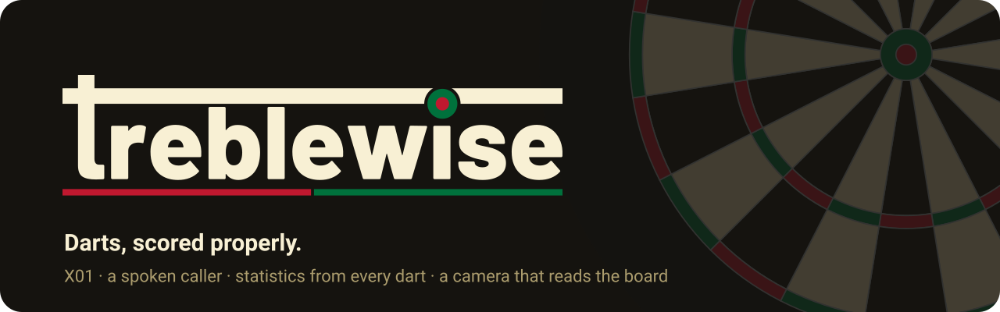
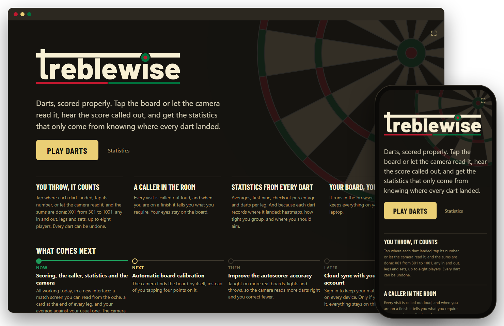

<p align="center">
  <a href="https://fre0grella.github.io/treblewise/">
    
  </a>
</p>

<p align="center">
  <a href="https://fre0grella.github.io/treblewise/"></a>
  <a href="LICENSE"></a>
  
  <a href="https://ko-fi.com/freogrella"></a>
</p>

<p align="center">
  <b><a href="https://fre0grella.github.io/treblewise/">Play it</a></b> ·
  <a href="docs/07-roadmap.md">Roadmap</a> ·
  <a href="#documentation">Docs</a> ·
  <a href="CONTRIBUTING.md">Contributing</a>
</p>

A web app for playing darts: X01 scoring, a spoken caller, checkout help, deep
statistics — and a camera autoscorer that reads the board and scores your darts
for you, running entirely in the browser. X01, tap-the-board scoring and the
spoken caller work today, on a phone or a laptop.

<p align="center">
  
</p>

> [!NOTE]
> **Experimental autoscoring.** The camera can score darts in a game, but only
> if you switch it on: no model has passed the accuracy bar on held-out photos
> of a real board yet, so it is off by default and every dart it enters can be
> corrected with a tap. See [`docs/03-autoscorer.md`](docs/03-autoscorer.md).

## Features

| | |
|---|---|
| 🎯&nbsp;**X01** | 301 → 1001 · straight, double, triple or master in and out · legs and sets · 1–8 players · a checkout route on every finishable score, following the out rule · every dart can be undone. |
| 👆&nbsp;**Board&nbsp;input** | Tap where the dart landed (a magnifying lens rises offset from your finger, so a treble is hittable on a phone screen) or tap its number. A tapped dart keeps its **position in board millimetres**, not just `T20`. |
| 🔊&nbsp;**Caller** | Every visit called out loud from ~440 recorded clips, the delivery rising with the score up to the 180. One MP3 pack with a byte-range index, fetched on the first tap; player names go through `speechSynthesis`. |
| 📈&nbsp;**Statistics** | Classical: 3-dart and first-9 average, checkout %, darts at double, a per-double table, scoring bands, the session trend. Positional: a heatmap, grouping along and across the sector, what happens when you go at your number, and an **aim map** built from your own spread. |
| 📷&nbsp;**Autoscorer** | The camera reads each dart as it lands and proposes the score; you correct the odd one, and each correction is a labelled training sample. *Experimental, off by default.* |
| 📱&nbsp;**Phone&nbsp;+&nbsp;laptop** | The phone is only a camera, the laptop runs the game. WebRTC, with the handshake carried by QR codes both ways: no signalling server, and it works on a hotspot with no internet. No webcam? A 103-character code instead. |
| 🔒&nbsp;**Local&#8209;first** | Everything lives in IndexedDB on your device. No account, and the photos you label stay there until you export them. |

## How it works

### Every dart is an event

```ts
type DartThrown = {
  type: 'dart.thrown'
  id: string
  ts: number
  pos?: { x: number; y: number }                      // mm from the bull, in the board plane
  hit: { sector: number; ring: Ring; value: number }
  source: 'manual' | 'voice' | 'auto'
  confidence?: number                                 // autoscorer only
}
```

A match is an append-only log of darts and `dart.corrected` events. Legs, sets,
busts, whose throw it is and who won are **folded from the log, never stored**,
so they cannot disagree with the darts, and a fixed statistics bug fixes your
history too. Positions are what make the positional statistics possible at all.

### The autoscorer pipeline

```
camera ──▶ change gate ──▶ rectify ──────▶ detect tips ──▶ reconcile ──▶ score ──────▶ propose
           64×64 grey      homography,     heatmap model,   which tip     mm → polar    call it,
           board crop:     board to a      128² grid at     is new since  → sector      or ask
           still + changed 512² top-down   stride 4         the last one  and ring      when unsure
```

- **One dart at a time.** Each dart is read as it lands, so dart 3 cannot hide
  dart 2's tip: dart 2 was already locked in.
- **Rectify first.** The model only ever sees one geometry (board filling the
  frame, 20 at the top), so camera angle and distance stop being things it has to
  learn.
- **In the browser.** ONNX Runtime Web on WebAssembly, loaded only when you
  switch proposals on. The model is checked by SHA-256 against its release
  manifest, so the app runs exactly the file that was evaluated, or nothing.
- **Calibration** is four board points you place once; `packages/core` fits the
  homography. Finding the board automatically is on the roadmap.

### Stack

| | |
|---|---|
| `packages/core` | Pure TypeScript, no DOM, no I/O: board geometry, X01 rules, checkout routes, statistics, homography. Tested with Vitest. |
| `apps/web` | Vue 3 (`<script setup>`), Vite 7, strict TypeScript checked by `vue-tsc`, Pinia, Vue Router. No component library. |
| `ml/` | Python: dataset loading, PyTorch training, evaluation against the accuracy gate, ONNX export. Weights are release artefacts, never committed. |
| Deploy | Static, on GitHub Pages; the tests gate every deploy. |

## What comes next

| | | |
|:-:|---|---|
| 🟢 | **Now** | **Scoring, the caller, statistics and the camera.** All working today. The camera already scores a match with the experimental autoscorer: it reads each dart, calls it, and you correct the odd one it gets wrong. |
| 🟡 | **Next** | **A better interface.** Screens redesigned for the phone, the laptop and a scoreboard you can read from the oche. |
| ⚪ | **Then** | **Automatic board calibration.** The camera finds the board by itself, instead of you tapping four points on it. |
| ⚪ | **Later** | **The autoscorer, out of experimental.** Once it has proved accurate on real boards, the camera scores by default and the switch goes away. |

Plans, not promises — the phases and the gates between them are in
[`docs/07-roadmap.md`](docs/07-roadmap.md).

## Quick start

```bash
npm install
npm test          # core rules + geometry
npm run dev       # app on http://localhost:5173
```

## Documentation

| Doc | What's in it |
|---|---|
| [01 – Product](docs/01-product.md) | Scope, the two device modes, what is deliberately not in v1. |
| [02 – Architecture](docs/02-architecture.md) | Packages, the event log, why every dart stores coordinates. |
| [03 – Autoscorer](docs/03-autoscorer.md) | The runtime choice (ONNX Runtime Web), the pipeline, the training plan, the accuracy gate. |
| [04 – Statistics](docs/04-stats.md) | Every stat, with its formula. |
| [05 – Dual device](docs/05-dual-device.md) | Pairing, WebRTC, signalling. |
| [06 – Voice](docs/06-voice.md) | Caller out loud, voice-controlled scoring, platform limits. |
| [07 – Roadmap](docs/07-roadmap.md) | Phases and the gates between them. |
| [08 – Licensing & data](docs/08-licensing-and-data.md) | What may and may not be used here. Read before importing anything. |

## Licence

[AGPL-3.0](LICENSE). The scorer and the autoscorer stay free and open source,
including for anyone who runs them as a service.

Caller voice: Chatterbox by Resemble AI. The wordmark is drawn from Barlow (SIL
OFL 1.1).

<p align="center">
  <a href="https://ko-fi.com/freogrella">☕ Buy me a coffee on Ko-fi</a>
</p>
