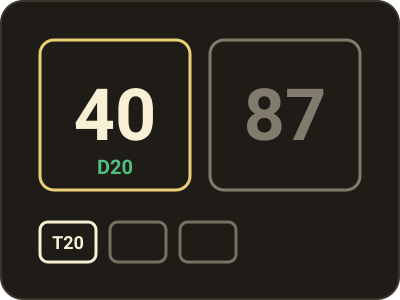
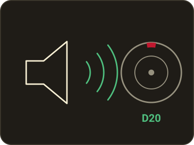
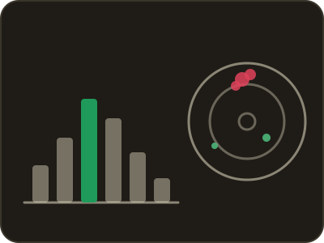
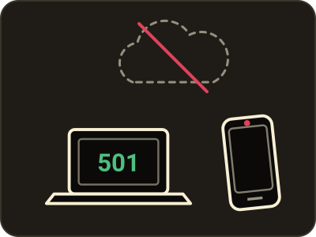
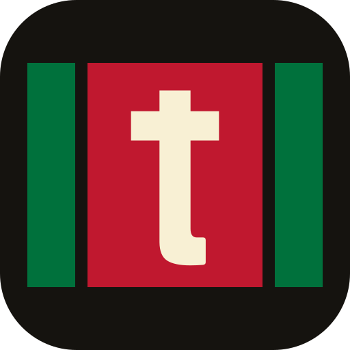

<p align="center">
  <a href="https://fre0grella.github.io/treblewise/">
    
  </a>
</p>

<p align="center">
  <a href="https://fre0grella.github.io/treblewise/"></a>
  <a href="LICENSE"></a>
  
  <a href="https://ko-fi.com/freogrella"></a>
</p>

<p align="center">
  <b><a href="https://fre0grella.github.io/treblewise/">Play it</a></b> ·
  <a href="docs/07-roadmap.md">Roadmap</a> ·
  <a href="#documentation">Docs</a> ·
  <a href="CONTRIBUTING.md">Contributing</a>
</p>

A web app for playing darts: X01 scoring, a spoken caller, checkout help, deep
statistics — and a camera autoscorer that reads the board and scores your darts
for you, running entirely in the browser. X01, tap-the-board scoring and the
spoken caller work today, on a phone or a laptop.

<p align="center">
  
</p>

> [!NOTE]
> **Experimental autoscoring.** The camera can score darts in a game, but only
> if you switch it on: no model has passed the accuracy bar on held-out photos
> of a real board yet, so it is off by default and every dart it enters can be
> corrected with a tap. See [`docs/03-autoscorer.md`](docs/03-autoscorer.md).

## At a glance

<table>
  <tr>
    <td width="50%" valign="top">
      <br>
      <h3>You throw, it counts</h3>
      Tap where each dart landed, tap its number, or let the camera read it,
      and the sums are done: X01 from 301 to 1001, any in and out, legs and
      sets, up to eight players. Every dart can be undone.
    </td>
    <td width="50%" valign="top">
      <br>
      <h3>A caller in the room</h3>
      Every visit is called out loud, and when you are on a finish it tells
      you what you require. Your eyes stay on the board.
    </td>
  </tr>
  <tr>
    <td width="50%" valign="top">
      <br>
      <h3>Statistics from every dart</h3>
      Averages, first nine, checkout percentage and darts per leg. And because
      each dart records where it landed: heatmaps, how tight you group, and
      where you should aim.
    </td>
    <td width="50%" valign="top">
      <br>
      <h3>Your board, your device</h3>
      It runs in the browser, works offline, and keeps everything on your
      phone or laptop. No account to create.
    </td>
  </tr>
</table>

<details>
<summary><b>Everything it does, in detail</b></summary>
<br>

| | |
|---|---|
| **Play** | X01 (301 → 1001), configurable in/out rule (straight / double / triple / master), legs and sets, 1–8 players. |
| **Score** | Three ways, always interchangeable: press the board, say it out loud, or let the camera read it. Pressing raises a magnifying lens offset from your finger, so you can place a dart in a treble on a phone screen. The camera never gets the last word — you do. |
| **Caller** | The score is spoken, so nobody has to look at the screen. |
| **Checkout** | What to aim at on every finishable score, following the configured out rule. |
| **Stats** | The usual ones (3-dart average, first 9, checkout %, darts per leg, bands, per-double table, session trend) plus the ones that need positions: a heatmap of where your darts land, how tightly they group along and across the sector, what happens when you go at your number, and — from your own spread — **where you should actually aim**, which for most players is not the treble 20. |
| **Camera setup** | Point the phone at your board and the app tells you what to fix — cut off, too dark, too straight on, camera moved — then you mark the four board points once. |
| **Try it** | Throw a dart, tap it in the photograph, hear the score called back. If it is right, the camera is set up properly — and that throw is one labelled training sample. In a game, the same thing happens per visit: **Mark where they landed** corrects the score and files the example. All of it stays on your device until you export it. |
| **Two device modes** | **Solo:** the phone does everything. **Paired:** the phone is only a camera and a laptop does the rest. Pairing is two QR codes and no server at all — or, for a computer with no camera, a 103-character code the phone offers to copy. The video goes straight between the devices and never leaves your network, so it works on a hotspot with no internet. |

Offline-first: it's a PWA, all game data lives on your device, and there is no
account to create.

</details>

## What comes next

| | | |
|:-:|---|---|
| 🟢 | **Now** | **Scoring, the caller, statistics and the camera.** All working today. The camera already scores a match with the experimental autoscorer: it reads each dart, calls it, and you correct the odd one it gets wrong. |
| 🟡 | **Next** | **A better interface.** Screens redesigned for the phone, the laptop and a scoreboard you can read from the oche. |
| ⚪ | **Then** | **Automatic board calibration.** The camera finds the board by itself, instead of you tapping four points on it. |
| ⚪ | **Later** | **The autoscorer, out of experimental.** Once it has proved accurate on real boards, the camera scores by default and the switch goes away. |

Plans, not promises — the phases and the gates between them are in
[`docs/07-roadmap.md`](docs/07-roadmap.md).

## The logo



The logo is the treble ring. The wordmark is *treblewise* in Barlow ExtraBold,
with the t's crossbar raised over the word and running on as a row of red and
green treble beds; the dot of the i is the bull. The icon is three beds close
up — green, red, green, treble 20 between the 5 and the 1 — with the same t in
the red one.

[`apps/web/scripts/build-logo.py`](apps/web/scripts/build-logo.py) draws all of
it from Barlow's outlines (SIL OFL 1.1): the wordmark, the favicon and the app
icons in [`apps/web/public/`](apps/web/public).
[`apps/web/scripts/build-readme-art.mjs`](apps/web/scripts/build-readme-art.mjs)
draws the pictures on this page from the running app.

## Quick start

```bash
npm install
npm test          # core rules + geometry
npm run dev       # app on http://localhost:5173
```

## Repository layout

```
packages/core/     Board geometry, X01 rules, checkout routes, stats. Pure TS, no DOM.
apps/web/          The app: Vue + Vite, PWA.
docs/              Plan, decisions and the licence map. Start with docs/07-roadmap.md.
ml/                Dataset loading, training, evaluation, ONNX export (Python; see ml/README.md).
services/pair/     (later) Signalling relay for phone↔laptop pairing.
```

## Documentation

| Doc | What's in it |
|---|---|
| [01 – Product](docs/01-product.md) | Scope, the two device modes, what is deliberately not in v1. |
| [02 – Architecture](docs/02-architecture.md) | Packages, the event log, why every dart stores coordinates. |
| [03 – Autoscorer](docs/03-autoscorer.md) | The runtime choice (ONNX Runtime Web), the pipeline, the training plan, the accuracy gate. |
| [04 – Statistics](docs/04-stats.md) | Every stat, with its formula. |
| [05 – Dual device](docs/05-dual-device.md) | Pairing, WebRTC, signalling. |
| [06 – Voice](docs/06-voice.md) | Caller out loud, voice-controlled scoring, platform limits. |
| [07 – Roadmap](docs/07-roadmap.md) | Phases and the gates between them. |
| [08 – Licensing & data](docs/08-licensing-and-data.md) | What may and may not be used here. Read before importing anything. |

## Licence

[AGPL-3.0](LICENSE). The scorer and the autoscorer stay free and open source,
including for anyone who runs them as a service.

Caller voice: Chatterbox by Resemble AI. The wordmark is drawn from Barlow (SIL
OFL 1.1).

<p align="center">
  <a href="https://ko-fi.com/freogrella">☕ Buy me a coffee on Ko-fi</a>
</p>
